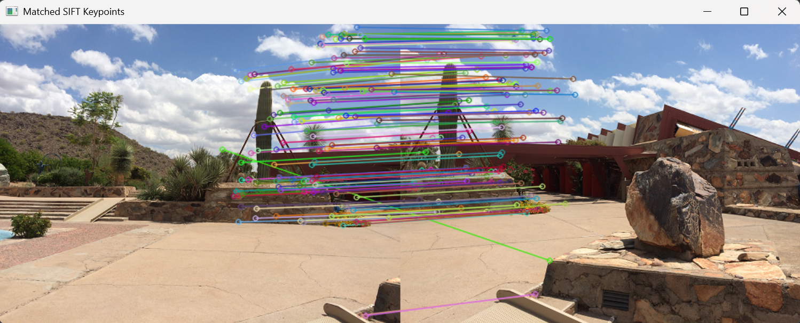
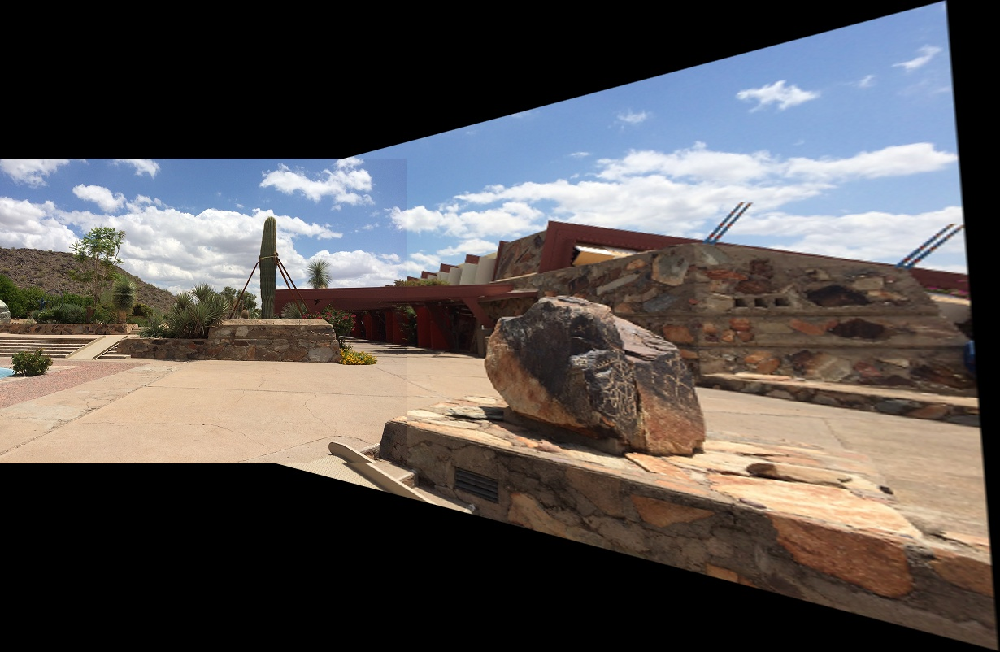

# 实验三 基于SIFT特征的图像拼接
### 一、实验目的
1. 理解SIFT尺度不变特征变换算法原理，掌握SIFT关键点检测与特征描述子提取方法。
2. 掌握FLANN特征匹配器、Lowe比率测试完成特征点对筛选的流程。
3. 理解单应矩阵（Homography）、RANSAC随机抽样一致性算法，学会求解图像之间的透视变换矩阵。
4. 掌握图像透视变换、坐标平移，实现两张存在重叠区域图像的全景拼接。
5. 熟悉OpenCV中SIFT、特征匹配、单应矩阵求解、透视变换相关 API 的使用。

### 二、实验内容
1. 读取待拼接的两张图a.png、b.png，转为灰度图像。

```python
import cv2 
import numpy as np  

img_a = cv2.imread("a.png") 
img_b = cv2.imread("b.png")
```


2. 创建SIFT检测器，检测两张图像关键点，提取特征描述子。

```python
# 将图像转换为灰度图
gray_a = cv2.cvtColor(img_a, cv2.COLOR_BGR2GRAY)
gray_b = cv2.cvtColor(img_b, cv2.COLOR_BGR2GRAY)
```

3. 构建FLANN匹配器，对描述子执行knn匹配（k=2）。

```python
# 初始化SIFT检测器并提取特征
sift = cv2.SIFT_create()
kp_a, des_a = sift.detectAndCompute(gray_a, None) # 图像a的关键点和描述符
kp_b, des_b = sift.detectAndCompute(gray_b, None) # 图像b的关键点和描述符

# 使用FLANN匹配器进行特征匹配
FLANN_INDEX_KDTREE = 1
index_params = dict(algorithm=FLANN_INDEX_KDTREE, trees=5)
search_params = dict(checks=50) # 检查次数越多,匹配越准确但速度越慢
flann = cv2.FlannBasedMatcher(index_params, search_params)
matches = flann.knnMatch(des_a, des_b, k=2) # k=2表示每个特征点返回2个最佳匹配
```

4. Lowe比率测试筛选优质匹配点对，绘制匹配结果图像，直观观察匹配效果。

```python
# 应用Lowe's比率测试筛选优质匹配点
good_matches = []
for m, n in matches:
    if m.distance < 0.7 * n.distance: # 比率阈值通常取0.7‑0.8
        good_matches.append(m)

# 绘制匹配的SIFT关键点
matched_keypoints_img = cv2.drawMatches(
    img_a, kp_a, img_b, kp_b, good_matches,
    None, flags=cv2.DrawMatchesFlags_NOT_DRAW_SINGLE_POINTS
)
```
5. 提取匹配点坐标，使用RANSAC求解单应矩阵H，代表b到a的透视变换。计算b图变换后的4个角点，联合a图角点计算全景画布最大最小坐标，得到画布宽高。

```python
# 提取匹配点的坐标
src_pts = np.float32([kp_b[m.trainIdx].pt for m in good_matches]).reshape(-1, 1, 2) # 图像b的关键点
dst_pts = np.float32([kp_a[m.queryIdx].pt for m in good_matches]).reshape(-1, 1, 2) # 图像a的关键点

# 使用RANSAC算法估计单应矩阵(透视变换矩阵)
H, _ = cv2.findHomography(src_pts, dst_pts, cv2.RANSAC, 5.0)

# 获取输入图像尺寸
h_a, w_a = img_a.shape[:2]
h_b, w_b = img_b.shape[:2]

# 计算图像b变换后的四个角点坐标
pts = np.float32([[0, 0], [0, h_b], [w_b, h_b], [w_b, 0]]).reshape(-1, 1, 2)
dst_corners = cv2.perspectiveTransform(pts, H)
```

6. 构造平移矩阵，消除负坐标，将平移矩阵与单应矩阵相乘得到最终变换矩阵。使用`warpPerspective`将图像b变换到全景画布；把图像a复制到画布对应位置。

```python
# 提取匹配点的坐标
src_pts = np.float32([kp_b[m.trainIdx].pt for m in good_matches]).reshape(-1, 1, 2) # 图像b的关键点
dst_pts = np.float32([kp_a[m.queryIdx].pt for m in good_matches]).reshape(-1, 1, 2) # 图像a的关键点

# 使用RANSAC算法估计单应矩阵(透视变换矩阵)
H, _ = cv2.findHomography(src_pts, dst_pts, cv2.RANSAC, 5.0)

# 获取输入图像尺寸
h_a, w_a = img_a.shape[:2]
h_b, w_b = img_b.shape[:2]

# 计算图像b变换后的四个角点坐标
pts = np.float32([[0, 0], [0, h_b], [w_b, h_b], [w_b, 0]]).reshape(-1, 1, 2)
dst_corners = cv2.perspectiveTransform(pts, H)

# 确定拼接后图像的最终尺寸(包含所有像素)
all_corners = np.concatenate([dst_corners, np.float32([[0,0], [w_a,0], [w_a,h_a], [0,h_a]]).reshape(-1,1,2)], axis=0)
[x_min, y_min] = np.int32(all_corners.min(axis=0).ravel() - 0.5)
[x_max, y_max] = np.int32(all_corners.max(axis=0).ravel() + 0.5)

# 创建平移矩阵,确保所有像素都在可见区域内
translation_matrix = np.array([[1, 0, -x_min], [0, 1, -y_min], [0, 0, 1]], dtype=np.float32)

# 对图像b进行透视变换和平移
stitched_img = cv2.warpPerspective(
    img_b, translation_matrix @ H, # 组合平移矩阵和单应矩阵
    (x_max - x_min, y_max - y_min) # 输出图像尺寸
)

# 将图像a复制到拼接结果的对应位置
stitched_img[-y_min : h_a - y_min, -x_min : w_a - x_min] = img_a
```

7.显示特征匹配图和拼接完成的全景图像，保存拼接结果。

```python
# 显示匹配关键点和拼接结果
cv2.imshow('Matched SIFT Keypoints', matched_keypoints_img) # 显示匹配的关键点
cv2.imshow('Stitched Result', stitched_img) # 显示拼接后的图像
cv2.waitKey(0) # 等待用户按键(按任意键关闭窗口)
cv2.destroyAllWindows() # 关闭所有显示窗口

# 保存拼接结果
cv2.imwrite("stitched_result.jpg", stitched_img)
print("拼接完成,结果已保存为 stitched_result.jpg")
```






### 三、实验结果
1. 特征匹配窗口Matched SIFT Keypoints

输出图像会并排展示原图a、原图b，匹配成功的特征点之间绘制连线。输出结果可以看到大量正确的对应点；
经过Lowe比率测试后，错误匹配连线大幅减少。若两张图片重叠充分，匹配连线整齐；若重叠过少，匹配点数量会下降，拼接会失败。

3. 拼接结果窗口Stitched Result，输出stitched_result.jpg

输出全景图像：图像b经过透视变换，和图像a在重叠区域对齐，两张图像融合在一张大图中。画布会自动扩展，容纳两张图像全部内容。

### 四、实验分析和结论
1. Lowe比率阈值：代码中阈值采用0.7；阈值调大，匹配点变多，但错误匹配增加；阈值调小，匹配点变少，但匹配更可靠。
2. 平移矩阵作用：图像b经过透视变换后部分角点坐标为负数，无法显示；平移矩阵把整体坐标偏移，全部像素移动到画布正坐标范围。
3. 掌握了图像拼接四大步骤：特征检测、特征匹配、求解透视变换、图像投影融合。
4. 理解单应矩阵、RANSAC、Lowe 比率测试在图像配准中的作用。
5. 本实验实现基础拼接，但重叠区域接缝明显，后续可以改进图像融合算法优化拼接效果。
