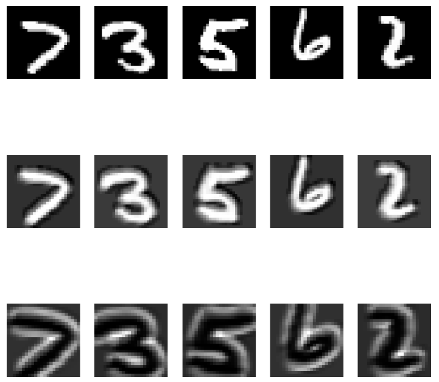

# LeNet‑5手写数字识别

## 一、实验目的
1. 理解 LeNet‑5卷积神经网络网络结构，掌握卷积层、池化层、全连接层的作用。
2. 掌握 PyTorch搭建卷积神经网络的基本流程：数据集加载、网络定义、前向传播、损失计算、反向传播、参数更新。
3. 使用MNIST手写数字数据集完成训练与测试，观察模型识别准确率；
4. 可视化卷积层输出的特征图，理解卷积提取图像特征的原理。
5. 熟悉 Adam优化器、交叉熵损失函数的使用，观察训练过程中损失、准确率变化。

## 二、实验原理

LeNet‑5是经典手写数字识别 CNN，网络流程：

1. conv1 卷积层：输入通道1，输出通道6，卷积核5×5，padding=2；激活 Sigmoid；2×2平均池化，步长2。输入 28×28，卷积 padding=2输出仍 28×28，池化后输出14×14，通道数6。
2. conv2 卷积层：输入通道6，输出通道16，卷积核5×5；激活 Sigmoid；2×2平均池化，步长2；输出5×5，通道16。
3. 全连接 fc1：将5×5×16=400个神经元映射到120，Sigmoid激活。
4. 全连接 fc2：120映射到84，Sigmoid激活。
5. 分类层 clf：84映射到10，对应10个数字类别。

## 三、实验步骤
1. 导入所需要的 torch、torchvision、matplotlib库, 设置 batch_size
```python
#%%
import torch
import torch.nn as nn
import torch.nn.functional as F
import torch.optim as optim
from torchvision import datasets,transforms
import matplotlib.pyplot as plt

batch_size = 512
device = torch.device('cuda' if torch.cuda.is_available() else 'cpu')
```

2. 加载 MNIST数据集，构建训练集、测试集 DataLoader，ToTensor()将图片转为张量。
```python
trainloader = torch.utils.data.DataLoader(datasets.MNIST('data',train=True,download = True,
                                                         transform=transforms.Compose([transforms.ToTensor()])),batch_size=batch_size,shuffle=True)

testloader = torch.utils.data.DataLoader(datasets.MNIST('data',train=False,download=True,
                                                        transform=transforms.Compose([transforms.ToTensor()])),batch_size=batch_size,shuffle=True)
```

4. 定义 Net 类继承nn.Module,实现网络前向计算流程：卷积‑激活‑池化‑卷积‑激活‑池化‑展平‑全连接‑分类输出。
```python
#%% 补全LeNet网络
class Net(nn.Module):
    def __init__(self):
        super(Net,self).__init__()
        #输入通道1,输出通道6,卷积核5×5, padding=2
        self.conv1 = nn.Conv2d(1,6,kernel_size=5,padding=2)
        #输入通道6, 输出通道16, 卷积核5×5
        self.conv2 = nn.Conv2d(6,16,kernel_size=5)
        #全连接层,输入5*5*16,输出120
        self.fc1 = nn.Linear(5*5*16,120)
        #全连接层,输入120, 输出84
        self.fc2 = nn.Linear(120,84)
        #分类层,输入84, 输出10
        self.clf = nn.Linear(84,10)

    def forward(self,x):
        #conv1
        x = self.conv1(x)
        x = F.sigmoid(x)
        #平均池化层,kernel=2x2, 步长2
        x = F.avg_pool2d(x,kernel_size=2,stride=2)

        #conv2
        x = self.conv2(x)
        x = F.sigmoid(x)
        #平均池化层,2x2, 步长2
        x = F.avg_pool2d(x,kernel_size=2,stride=2)

        #展平,从第1维开始展平
        x = torch.flatten(x,start_dim=1)

        #全连接层1 激活函数sigmoid()
        x = self.fc1(x)
        x = F.sigmoid(x)

        #全连接层2 激活函数sigmoid()
        x = self.fc2(x)
        x = F.sigmoid(x)

        #分类层
        x = self.clf(x)
        return x
```
5. 实例化模型，Adam 优化器设置学习率0.01。
```python
model = Net().to(device)
optimizer = optim.Adam(model.parameters(), lr = 1e-2)
epochs=30
accs,losses = [],[]
```
6. 循环训练 30 轮：

训练阶段：清零梯度、前向传播、交叉熵损失、反向传播、更新参数。

测试阶段：计算测试集损失和识别准确率。
 ```python
 for epoch in range(epochs):
    #训练
    model.train()
    for batch_idx, (x,y) in enumerate(trainloader):
        x,y = x.to(device),y.to(device)
        optimizer.zero_grad()
        out = model(x)
        loss = F.cross_entropy(out,y)
        loss.backward()
        optimizer.step()

    #测试
    model.eval()
    correct=0
    testloss=0
    with torch.no_grad():
        for batch_idx, (x,y) in enumerate(testloader):
            x,y= x.to(device),y.to(device)
            out = model(x)
            testloss += F.cross_entropy(out,y).item()
            pred= out.max(dim=1,keepdim=True)[1]
            correct += pred.eq(y.view_as(pred)).sum().item()

    acc = correct/len(testloader.dataset)
    testloss = testloss/(batch_idx+1)
    accs.append(acc)
    losses.append(testloss)
    print('epoch:{}, loss:{:.4f}, acc:{:.4f}'.format(epoch, testloss,acc))
 ```
7. 输出每轮 epoch测试损失 loss和准确率 acc。
```python
epoch:0, loss:1.4730, acc:0.4288
epoch:1, loss:0.3500, acc:0.8951
epoch:2, loss:0.2030, acc:0.9380
epoch:3, loss:0.1414, acc:0.9550
epoch:4, loss:0.0937, acc:0.9706
epoch:5, loss:0.0959, acc:0.9700
epoch:6, loss:0.0671, acc:0.9782
epoch:7, loss:0.0602, acc:0.9800
epoch:8, loss:0.0569, acc:0.9820
epoch:9, loss:0.0610, acc:0.9825
epoch:10, loss:0.0516, acc:0.9844
epoch:11, loss:0.0445, acc:0.9863
epoch:12, loss:0.0501, acc:0.9851
epoch:13, loss:0.0457, acc:0.9859
epoch:14, loss:0.0513, acc:0.9847
epoch:15, loss:0.0438, acc:0.9870
epoch:16, loss:0.0423, acc:0.9876
epoch:17, loss:0.0425, acc:0.9877
epoch:18, loss:0.0474, acc:0.9869
epoch:19, loss:0.0472, acc:0.9861
epoch:20, loss:0.0487, acc:0.9869
epoch:21, loss:0.0455, acc:0.9878
epoch:22, loss:0.0500, acc:0.9872
epoch:23, loss:0.0500, acc:0.9860
epoch:24, loss:0.0570, acc:0.9855
epoch:25, loss:0.0509, acc:0.9869
epoch:26, loss:0.0508, acc:0.9867
epoch:27, loss:0.0508, acc:0.9874
epoch:28, loss:0.0529, acc:0.9865
epoch:29, loss:0.0491, acc:0.9883
```
8. 取出卷积层输出 feature1、feature2，对原始图片、第一层卷积特征图、第二层卷积特征图可视化。
```python
#%% 特征图可视化
#取一批数据
x, y = next(iter(testloader))
x = x.to(device)
feature1 = F.sigmoid(model.conv1(x))
feature2 = F.sigmoid(model.conv2(feature1))

n=5
img = x.detach().cpu().numpy()[:n]
feature_map1 = feature1.detach().cpu().numpy()[:n]
feature_map2 = feature2.detach().cpu().numpy()[:n]

fig, ax = plt.subplots(3, n, figsize=(10, 10))
for i in range(n):
    ax[0,i].imshow(img[i].sum(0),cmap='gray')
    ax[1,i].imshow(feature_map1[i].sum(0),cmap='gray')
    ax[2, i].imshow(feature_map2[i].sum(0),cmap='gray')
    ax[0,i].axis('off')
    ax[1,i].axis('off')
    ax[2,i].axis('off')
plt.show()
```
输出为：


## 四、 训练输出结果

1. 训练30个 epoch，随着 epoch增加：

- 测试集 loss不断下降，逐渐收敛；
- 测试集准确率逐步上升，最终测试集准确率为98.83%

2. 特征图可视化结果

- 第一行：原始 MNIST手写数字灰度图像；
- 第二行：conv1卷积层输出特征图，主要提取图像边缘、轮廓，图像还保留较多原始信息；
- 第三行：conv2卷积层输出特征图，特征更加抽象，提取高级语义，部分细节消失，重点突出数字关键模式。
- 现象：浅层卷积看边缘轮廓；深层卷积提取更抽象特征。

